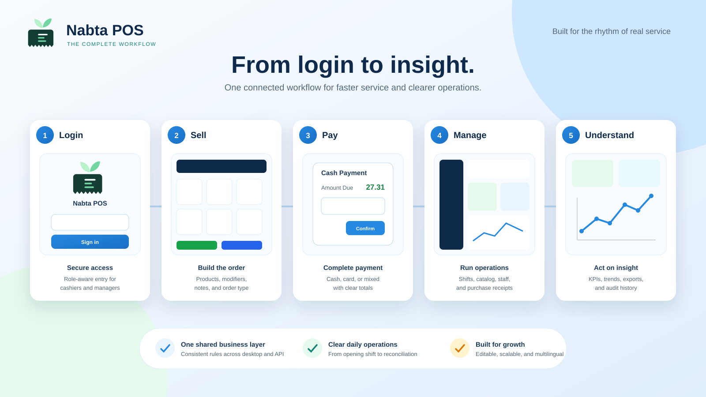
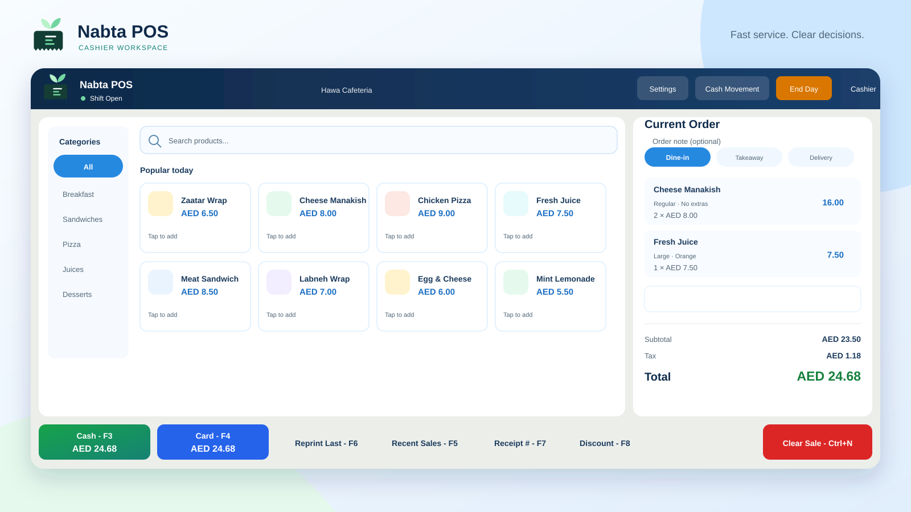
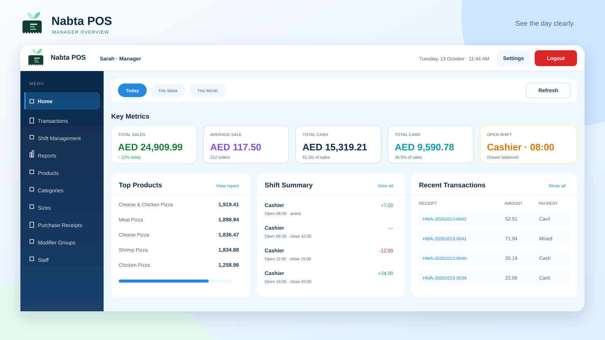
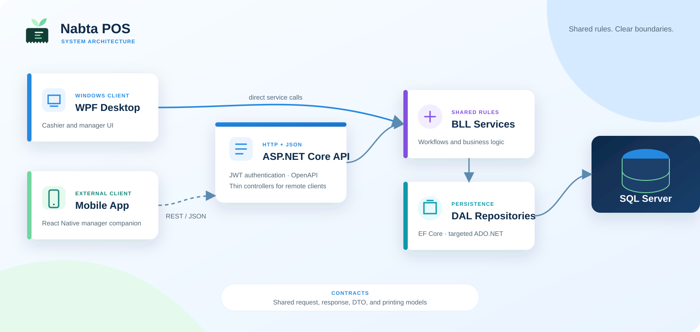

# Nabta POS

Nabta POS is a point-of-sale system for cafeteria operations. It includes a Windows cashier and manager application, an ASP.NET Core API, and a React Native manager companion maintained in a separate codebase.

This repository contains the desktop app, API, shared business logic, data-access layer, database source, and tests. The external mobile app consumes the API over REST/JSON; it does not connect directly to SQL Server.

## Screenshots



| Cashier dashboard | Manager dashboard |
|---|---|
|  |  |

Additional screenshots: [login](01_Login.svg) and [payment](03_Payment.svg).

## Features

### Cashier

- Product browsing, variants, modifiers, order types, and cart management
- Cash, card, and mixed-payment checkout
- Manager-approved discounts and voids with audit attribution
- PDF receipt generation and thermal receipt printing
- Recent-sale and receipt lookup
- Configurable keyboard shortcuts and touch-friendly controls

### Manager

- Sales KPIs, transaction history, reporting, and Excel export
- Shift opening/closing, cash movements, and drawer reconciliation
- Product, category, size, modifier, and translation management
- Purchase receipt and supplier management
- Staff, roles, permissions, and audit-log views
- Printer, receipt, language, display-scale, and shortcut settings
- Mobile access to supported management workflows through the API

### Platform

- English, Arabic, and Malayalam UI resources with runtime language switching
- Role-based access with BCrypt/Argon2 credential hashing
- SQL Server persistence through EF Core, with targeted ADO.NET and stored procedures for measured hot paths
- JWT-authenticated API endpoints for login, refresh, dashboards, reports, transactions, shifts, categories, products, and audit logs

## Architecture



- The WPF application and API are separate composition roots that reuse the BLL, DAL, and Contracts projects.
- The WPF UI calls business services directly; the mobile app reaches them through the API.
- EF Core is the default persistence model. Raw SQL is reserved for stored-procedure-heavy or performance-sensitive paths.
- DAL entities do not cross the data-access boundary; callers use DTOs and response models.
- API controllers remain thin and delegate work to BLL services.

## Tech stack

| Area | Technology |
|---|---|
| Desktop | WPF on .NET 10 (`net10.0-windows`) |
| Desktop pattern | MVVM, dependency injection, custom relay commands |
| Mobile (external) | React Native, TypeScript, Expo |
| Mobile state/navigation | TanStack Query, React Navigation |
| API | ASP.NET Core 10, JWT bearer authentication, OpenAPI, Scalar |
| Persistence | EF Core 10, ADO.NET, SQL Server |
| PDF and printing | QuestPDF |
| Excel export | ClosedXML |
| Security | BCrypt.Net-Next, Argon2 |
| Tests | xUnit |

## Repository layout

```text
PointOfSale/
├── Contracts/                  # Shared DTOs, requests, responses, and printing models
├── BLL/                        # Business services and application rules
├── DAL/                        # EF Core entities/configuration, repositories, and SQL source
│   └── db/                     # Authoritative schema, procedures, views, indexes, and seed data
├── POS.Api/                    # ASP.NET Core REST API used by external clients
├── WPF/                        # Windows desktop app, views, ViewModels, controls, and themes
├── Tests/POS.Business.Tests/   # Business and SQL-contract tests
├──                        # Plans, references, and screenshots
└── .codesight/                 # Generated repository map and subsystem wiki
```

The React Native mobile project is intentionally stored outside this repository.

## Prerequisites

- Windows 10 or 11
- [.NET 10 SDK](https://dotnet.microsoft.com/download/dotnet/10.0)
- SQL Server with permission to create the `POS_DB` database
- `sqlcmd` if you want to deploy the database from the command line


The suite covers payment reconciliation, discounts and VAT, void authorization, duplicate/concurrent operations, cash movements, drawer math, and the SQL contracts used by transaction workflows. Tests that require a live SQL Server need a configured POS database; the remaining tests run without one.

## License

Proprietary — contact the repository owner for details.
